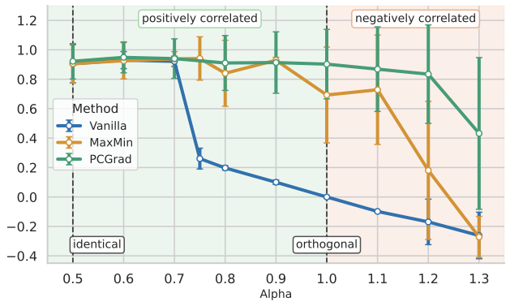

# Not All Reward Heterogeneity is Value Conflict: Gradient Interference in Group-Aware RLHF

Research code for studying how heterogeneous preferences become policy updates in reinforcement learning from human feedback (RLHF). On a controlled IMDb benchmark, we distinguish **value-level conflict** between group preferences from **optimization-level interference** between their learning signals.

## Overview

Poor minority alignment does not necessarily imply an unavoidable trade-off between groups. The manuscript reports three main findings:

- **Minority collapse can occur while group rewards remain positively correlated.** Vanilla RLHF exhibits a sharp decline near preference divergence \(\alpha = 0.75\), where the measured reward correlation is approximately 0.65.
- **Harmful gradient alignment is strongest early in training.** PPO updates initially oppose minority reward improvement; later positive alignment does not necessarily restore minority performance.
- **How group gradients are combined matters.** Worst-group selection and direct gradient summation help under moderate heterogeneity, while gradient conflict correction method (PCGrad and MGDA) retain stronger worst-group performance under larger divergence.

These findings concern synthetic preference groups in a controlled benchmark. Positive reward correlation alone does not establish that every policy update can improve both groups, and the experiments do not characterize the full Pareto frontier.

## Benchmark

Prompts are the first 2–8 tokens of IMDb reviews. Candidate responses are generated using `lvwerra/gpt2-imdb` and scored along two attributes:

- **Positive sentiment** $r_s$: the positive-class score from `lvwerra/distilbert-imdb`.
- **Conciseness** $r_c$: a score derived from response length.

The population contains 80% majority preferences and 20% minority preferences. Their oracle rewards are

$$
r_{\mathrm{maj}} = \alpha r_s + (1-\alpha)r_c,
\qquad
r_{\mathrm{min}} = (1-\alpha)r_s + \alpha r_c.
$$

The manuscript varies $\alpha$ from 0.5 to 1.3. At 0.5 the rewards are identical; at 1.0 each group values a different attribute; above 1.0 each group assigns a negative coefficient to the other attribute. The measured reward correlation becomes negative in this last regime.

Policy optimization uses **mean per-token KL** regularization to reduce confounding from response length. Evaluation reports oracle group rewards, worst-group reward $F=\min(J_{\mathrm{min}},J_{\mathrm{maj}})$, and population utility $U=0.2J_{\mathrm{min}}+0.8J_{\mathrm{maj}}$.

## Methods

All main methods use PPO to train policy. Group-aware methods share the same separately trained minority and majority reward models.

| Method | CLI value | Policy update |
|---|---|---|
| Vanilla RLHF | `vanilla` | Optimize one reward model trained on pooled preferences. |
| MaxMin-RLHF | `maxmin` | Select the group with the lowest **batch-mean** learned reward and use its rewards for the entire batch. |
| SumGrad | `sumgrad` | Sum both group-specific PPO gradients without projection. |
| PCGrad-PPO | `pcgrad` | Project conflicting components out of both group gradients, then sum them. |
| MGDA-PPO | `mgda` | Compute the minimum-norm convex combination of the two group gradients. |

For SumGrad, PCGrad, and MGDA, the KL-related policy gradient is added separately after combining group gradients. The value model uses the standard PPO value loss. MGDA uses unnormalized group gradients by default (`MGDA_NORMALIZE=0`).

### Worst-group performance across preference divergence

[](notebooks/ppo_by_alpha_worst.pdf)

Vanilla RLHF exhibits worst-group collapse while group rewards remain positively correlated. MaxMin improves performance under moderate divergence, while PCGrad maintains higher worst-group rewards as preferences become more conflicting. Click the figure to open the vector PDF.

The manuscript additionally compares Vanilla, MaxMin, and PCGrad on Pythia-160M and Llama-3.2-1B at α = 1.0, observing minority collapse and recovery beyond GPT-2.

## Setup

The training scripts target Linux with Bash and an NVIDIA GPU. The manuscript used one RTX 5090 GPU per run on Ubuntu 24.04.3 with CUDA 12.8.

Create an environment and install the dependencies:

```bash
python3 -m venv .venv
source .venv/bin/activate
python -m pip install -r requirements.txt
```

Authenticate with Hugging Face and Weights & Biases:

```bash
hf auth login
wandb login
```

```bash
export USER_ID="your-hf-username"
export SEED=42
export PROPORTION=0.2
export CUDA_VISIBLE_DEVICES=0
```

## Run the experiments

Run commands from the repository root. Start with one preference setting; the examples below use \(\alpha = 1.0\).

### 1. Build preference datasets

Generate candidate responses, score sentiment and length, and construct group-labeled chosen/rejected pairs:

```bash
ALPHA=1.0 MAX_NEW_TOKENS=512 bash scripts/build_dataset.sh
```

To prepare an alpha sweep, use `ALPHA_RANGE`. Once the raw responses have been generated and scored, reuse them with `SKIP_GENERATE=1 SKIP_SCORE=1`:

```bash
SKIP_GENERATE=1 SKIP_SCORE=1 \
ALPHA_RANGE="0.5 0.6 0.7 0.75 0.8 0.9 1.0 1.1 1.2 1.3" \
MAX_NEW_TOKENS=512 bash scripts/build_dataset.sh
```

### 2. Train and evaluate

The pipeline trains the pooled and two group-specific reward models, trains the selected PPO policies, then generates and scores evaluation responses:

```bash
ALPHAS="1.0" \
METHODS="vanilla maxmin sumgrad pcgrad mgda" \
POLICY_MODEL_NAMES="gpt2" \
KL_DIV=mean_kl KL_COEF=0.1 \
MAX_NEW_TOKENS=512 EVAL_MAX_NEW_TOKENS=256 \
NO_REWARD_NORM=1 \
bash scripts/run_train_eval_pipeline.sh
```

Set `ALPHAS` to the desired space-separated sweep after preparing its preference datasets. Use `SKIP_REWARD_TRAINING=1` to reuse reward models or `SKIP_PPO_TRAINING=1` to reuse trained policies.

The stages are also available separately:

```bash
# Train pooled, minority, and majority reward models.
ALPHAS="1.0" SKIP_NORM=1 bash scripts/train_reward_models.sh

# Train PPO policies for one alpha. This script uses singular ALPHA.
ALPHA=1.0 METHODS="vanilla maxmin sumgrad pcgrad mgda" \
NO_REWARD_NORM=1 bash scripts/train_ppo_policy.sh

# Evaluate a specific trained policy; supply its full Hub ID.
POLICIES="${USER_ID}/pcgrad-imdb-ppo-prop0.2-alpha1.0-seed${SEED}-mean_kl0.1-gpt2" \
bash scripts/evaluate_ppo_policy.sh
```

The standalone evaluation script has author-specific default policy IDs, so set `POLICIES` explicitly when evaluating your own runs. `NO_REWARD_NORM=1` disables reward-model calibration; it does not disable PPO reward whitening.

### Main settings

| Setting | Manuscript / main workflow |
|---|---|
| Minority proportion | 0.2 |
| Main policy backbone | GPT-2 |
| PPO episodes | 50,000 |
| PPO epochs per batch | 3 |
| Effective batch size | 64 |
| Learning rate | `3e-6`, cosine schedule |
| KL | Mean per-token KL, coefficient 0.1 |
| Precision | bf16 |
| PPO reward whitening | Enabled |
| Maximum new tokens | 512 during training, 256 during evaluation |

The scripts expose `LEARNING_RATE`, `TOTAL_EPISODES`, `KL_DIV`, `KL_COEF`, and other overrides. Each script launches Python directly. For additional backbones, configure the reward and policy models consistently using `REWARD_MODEL_BASE`, `POLICY_MODEL_NAMES`, and the matching `RM_SUFFIX` in the individual training scripts.

### 3. Analyze results and gradients

Open [the alpha analysis notebook](notebooks/analyze_ppo_by_alpha.ipynb) to compare group rewards, population utility, reward correlations, and MaxMin training trajectories:

```bash
mkdir -p images/with_sumgrad
jupyter lab notebooks/analyze_ppo_by_alpha.ipynb
```

Update the notebook's `USER_ID`, evaluation dataset IDs, seeds, and W&B run IDs to match your experiments. Its existing configuration combines historical runs with different seeds and naming conventions; it is not automatically connected to newly trained policies. Run it with `notebooks/` as the working directory for its relative figure-output paths.

For group-gradient cosine traces during PCGrad, SumGrad, or MGDA training:

```bash
ALPHA=1.0 METHODS="pcgrad sumgrad mgda" RECORD_COSINE=1 \
bash scripts/train_ppo_policy.sh
```

These traces are written under `diagnostics/`. Additional diagnostic tools cover vanilla/group gradient alignment, reward-scale comparisons, and reward calibration in [src/imdb/diagnostics](src/imdb/diagnostics).


## Repository layout

```text
scripts/
  build_dataset.sh                 Generate, score, and construct preferences
  train_reward_models.sh           Train pooled and group-specific reward models
  train_ppo_policy.sh              Train PPO policies
  evaluate_ppo_policy.sh           Generate and score evaluation responses
  run_train_eval_pipeline.sh       Run reward training, PPO, and evaluation
src/
  helper/                         Shared data, model, and scoring utilities
  imdb/dataset/                   Preference dataset construction
  imdb/reward_training/           Reward training and normalization
  imdb/ppo_training/              PPO and gradient-combination methods
  imdb/evaluation/                Response generation and evaluation
  imdb/diagnostics/               Gradient and reward-scale diagnostics
notebooks/
  analyze_ppo_by_alpha.ipynb       Main alpha-sweep analysis and figures
  inspect_vanilla_conciseness.ipynb Response-length inspection
```

## Acknowledgments

This repository builds on [sharedrep-rlhf](https://github.com/marcellobullo/sharedrep-rlhf) and the [MaxMinRLHF implementation](https://github.com/CharlesQ9/MaxMinRLHF). PPO training uses TRL. The gradient-coordination comparisons use PCGrad (Yu et al., 2020) and MGDA (Sener and Koltun, 2018).
