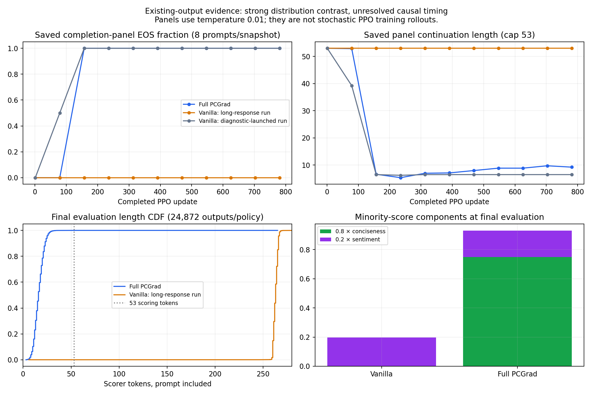

The strongest recovered existing evidence establishes a persistent absence of
concise responses in one vanilla run, a conciseness-driven minority deficit,
and a contrasting acquisition of short responses by Full PCGrad. It does not
establish that late correction cannot work. No correction is applied to the
vanilla trajectory, no matched late intervention is included here, and the
reported cosine transition remains unavailable.

The source runs are [long-response vanilla, wp3u80m8](https://wandb.ai/mxcui-none/huggingface/runs/wp3u80m8),
[Full PCGrad, 541g6ruj](https://wandb.ai/mxcui-none/huggingface/runs/541g6ruj),
and [diagnostic-launched vanilla, 20n9qhn5](https://wandb.ai/mxcui-none/huggingface/runs/20n9qhn5).
An older vanilla run, `f8v0lc6k`, was retained in the archived data as another
contrary example. These are exploratory case comparisons, not matched causal
experiments or independent training-seed replicates. Their resolved PPO seed is
42 despite seed43/seed44 names and launch arguments in some runs.

The final datasets are the [long-response vanilla evaluation](https://huggingface.co/datasets/mxcui/vanilla-imdb-ppo-eval-prop0.2-alpha0.8-seed43-mean_kl0.1-gpt2)
at revision `24173d99385d977ebff1cfcaefca0946d3e002d7` and
[Full PCGrad evaluation](https://huggingface.co/datasets/mxcui/pcgrad-imdb-ppo-eval-prop0.2-alpha0.8-seed43)
at revision `690ff99b77ad76f30f4dfaba9a3ffdfcb0742342`. Run associations follow
matching names and distinctive response patterns; checkpoint hashes are not
embedded in the evaluation rows, so exact model-to-evaluation mapping remains
unverified.

Final evaluation uses the current notebook's uniform oracle convention:
`c = 1 - clip(length / 256, 0, 1)`, minority `0.8*c + 0.2*s`, majority
`0.2*c + 0.8*s`. Length is sentiment-scorer tokens including the prompt, not PPO
continuation tokens. Stored dataset conciseness is instead `256 - length` and
can be negative; these raw stored values were not mixed with clipped scores.

| Final evaluation | Long-response vanilla | Full PCGrad |
| --- | ---: | ---: |
| Responses | 24,872 | 24,872 |
| Mean scoring length | 262.98 | 16.50 |
| Scoring length at most 53 | 2 (0.0080%) | 24,871 (99.9960%) |
| Scoring length at most 20 | 2 | 19,548 |
| Zero clipped conciseness | 24,854 (99.9276%) | 1 |
| Mean conciseness | 0.000100 | 0.935564 |
| Mean sentiment | 0.985655 | 0.904227 |
| Mean minority oracle score | 0.197211 | 0.929297 |
| Mean majority oracle score | 0.788544 | 0.910494 |

Thus the vanilla failure is almost entirely lack of conciseness, not weak
sentiment. Decomposing the Full-minus-vanilla minority gap exactly gives

    0.732086 = 0.748371 from conciseness - 0.016286 from sentiment.

Vanilla has better sentiment, but that gain is insufficient to compensate for
the missing minority-preferred attribute. Nearly all of its minority reward
comes from the 0.2-weighted sentiment term. This is an algebraic decomposition
of measured outcomes, not a causal mediation estimate.

The difference persists on **4,648 identical unique prompt strings** appearing
in both evaluation datasets. Responses sharing a prompt are averaged first,
then each common prompt has equal weight:

| Common-prompt comparison | Long-response vanilla | Full PCGrad |
| --- | ---: | ---: |
| Mean scoring length | 262.73 | 16.26 |
| Mean minority score | 0.19726 | 0.93094 |
| Mean per-prompt short-response fraction (at most 53 scoring tokens) | 0% | 100% |

A descriptive paired prompt bootstrap gives the minority difference 0.73369
an interval [0.73247, 0.73477]. This only describes prompt uncertainty conditional
on these policies and archived generations. It does not control training seed,
software, objectives, reward checkpoints or evaluation decoding, and cannot
establish a causal timing effect. The 0%/100% subset rates are empirical
observations; they do not prove true generation probabilities of zero or one.

Saved completion panels add temporal evidence. They contain eight held-out
prompts at updates 1, 79, 157, 235, 313, 391, 469, 547, 625, 703 and 781. Global
updates were recovered from W&B history, not inferred from media filenames.
Responses were truncated at their first EOS, avoiding repeated padding/EOS
markers being counted as response content.

| Snapshot | Vanilla EOS / 8 | Full EOS / 8 | Vanilla mean continuation length | Full mean continuation length |
| --- | ---: | ---: | ---: | ---: |
| 1 | 0 | 0 | 53.0 | 53.0 |
| 79 | 0 | 0 | 53.0 | 52.875 |
| 157 | 0 | 8 | 53.0 | 6.625 |
| 391 | 0 | 8 | 53.0 | 7.125 |
| 781 | 0 | 8 | 53.0 | 9.25 |

Every one of the long-response vanilla's 88 saved panel responses lacks EOS and
has retokenized length 53. Full learns short responses by the update-157 panel.
Both panels start long, so this supports failure to **acquire** concise behavior
more directly than loss of initially demonstrated concise behavior.

The standard upstream PPO panel uses temperature 0.01, compared with training
temperature 0.7, and is separate from the stochastic PPO rollout batches.
Historical custom source is not completely archived. These panels characterize
dominant near-greedy response behavior; they cannot estimate the probability of
short responses in the training rollout distribution. The final evaluation is
also a different generation distribution. Do not label panel EOS fractions as
training rollout EOS fractions or pool snapshots as 88 independent prompts.

Within the long-response vanilla run, learned pooled reward rises from 0.1295
to 4.2342, while mean token entropy falls from 2.0943 to 0.2261. It develops
repetitive positive language such as “distinguished” and “exciting” without
terminating in the saved panels. This supports a concentrated, reward-seeking
long-response mode. The **pooled learned reward does not collapse** in this run;
the low outcome is minority oracle performance. Full's learned objective has a
different definition, so raw reward levels should not be compared across arms.

For 99.9276% of vanilla's final outputs, clipped conciseness is zero. On that
observed subset, oracle rewards reduce to `r_min = 0.2*s` and `r_maj = 0.8*s`:
they have the same sentiment rankings despite low absolute minority reward.
This provides a concrete explanation of how positive reward alignment can
coexist with a collapsed attribute. It does not prove the actual learned-RM
surrogate cosine is driven by sentiment: that requires the missing diagnostics
or scoring the diagnostic responses with each reward component. Nor does it
make the true expected conciseness gradient zero; rare shorter responses may
still provide a recovery direction.

The contradictory vanilla run is important. `20n9qhn5` was launched with
`--diag_every 5 --diag_beta 0.1 --diag_max_new_tokens 200` and the path
`results/online_gradient_cosine_alpha08_seed44_decomp_beta01.csv`. Yet its saved
panels also reach 8/8 EOS responses at update 157, averaging 6.5 continuation
tokens; at update 781 they still average 6.5. The older vanilla run `f8v0lc6k`
also learns short responses, some nearly empty. Thus vanilla does not universally
fail to learn concise responses, and the named diagnostic run cannot be assumed
to be the long-response run. The diagnostic file was not among uploaded W&B
files, and no cosine keys were found in its full 793-row history. The pooled RM
repository's visible history shows its last update on March 2, before both the
March 3 long-response run and the May 25 diagnostic-launched run; it provides no
evidence of an intervening RM upload explaining their divergence. Exact historical
loaded revisions and custom source are still unresolved.

To connect this evidence to the reported cosine transition, recover the CSV
from its original server and identify its run. Required columns are update,
cosine, the two gradient norms, beta/reference settings and learned group means.
If the CSV belongs to `20n9qhn5`, its short-response trajectory must be reconciled
with the proposed mechanism; pairing it with the long-response run would be an
invalid cross-run causal narrative. After identifying a compatible run, overlay
cosine and norms with its own response snapshots and any archived group scores.
Use actual rollout text if available, rather than near-greedy panels, to test
the claimed change in training support.

What these existing data support:

“In the identified vanilla run, dominant sampled-panel behavior remains long
throughout training, and concise outputs are nearly absent at final evaluation.
Its minority deficit is attributable to conciseness despite high sentiment and
rising pooled reward. Full PCGrad develops short responses early and has high
minority performance, including on identical evaluation prompts. These results
are consistent with a persistent on-policy distribution failure, but do not
identify the causal role of early projection or demonstrate inability of a
late intervention to recover.”

There is no late correction in this vanilla run. A later positive cosine is
neither a correction nor a counterfactual intervention. Full versus vanilla
also changes group-objective construction, not just projection; without matched
SumGrad and timing controls, those effects cannot be isolated. Exclude the old
BF16 windowed results from any timing argument until their precision problem is
resolved in fresh experiments.

Reproduce all summaries and the figure offline with
`venv/bin/python analysis/existing_full_vanilla/analyze.py`. Inputs are
[panel_responses.csv](panel_responses.csv), [ppo_metrics.csv](ppo_metrics.csv),
[final_evaluation.csv](final_evaluation.csv) and [provenance.json](provenance.json).
Outputs are [findings.json](findings.json), [snapshot_summary.csv](snapshot_summary.csv)
and [existing_evidence.png](existing_evidence.png). This analysis used existing
outputs only: no policy training or new policy generations were launched.
