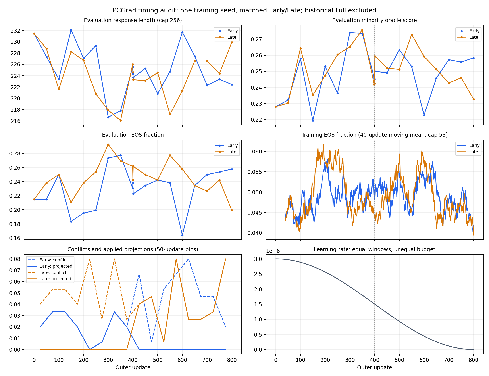

**Follow-up configuration audit:** [CONFIG_DIAGNOSIS.md](CONFIG_DIAGNOSIS.md)
identifies a major FP32-versus-BF16 parameter-storage mismatch. More than 99% of
the saved windowed policy parameters remain identical to rounded initialization.
Resolve this issue before using these runs to interpret a timing mechanism.

This audit finds weak endpoint evidence favoring Early PCGrad, but no convincing
evidence that omitting early PCGrad produces longer training rollouts or an
irreversible loss of conciseness. Both arms largely retain the initial policy's
long-response behavior. The most useful findings concern rollout censoring,
sparse and mild gradient conflicts, and unequal learning-rate budgets.

Source: `runs/windowed-len53-batch64-seed43-20261012_195052`. Early applies PCGrad
at outer updates 1–400; Late at 401–800; both use SumGrad outside their window.
Each outer update has three gradient updates. Both completed all 800 updates,
with 64 training responses per update and 256 fixed evaluation prompts at each
of 19 snapshots. The existing analyzer's `--check_only` passed for both arms,
covering rollout schedules, prompt identities, gradient rows and intervention
flags. Frozen input metadata and source hashes match. No training was launched
or modified. The autoresearch controller reports `not_initialized`; this is an
analysis of archived results, not a new optimization run.

The endpoint comparison is real as a descriptive measurement:

| Evaluation measurement | Initial, both arms | Early, update 400 | Late, update 400 | Early, update 800 | Late, update 800 |
| --- | ---: | ---: | ---: | ---: | ---: |
| Generated continuation length, policy tokens | 231.48 | 224.38 | 224.58 | 222.43 | 229.91 |
| Conciseness, scorer tokens, prompt included | 0.1068 | 0.1305 | 0.1340 | 0.1400 | 0.1132 |
| Positive sentiment | 0.7132 | 0.7041 | 0.6767 | 0.7321 | 0.7110 |
| Minority oracle score | 0.2280 | 0.2452 | 0.2425 | 0.2584 | 0.2327 |
| Responses containing EOS | 21.48% | 23.83% | 24.22% | 25.78% | 19.92% |

Conciseness is `1 - clip(scoring_length / 256, 0, 1)`; minority oracle score
is `0.8 * conciseness + 0.2 * sentiment`. These are offline oracle measurements,
not the learned reward logits used to train PPO. Generated length includes EOS;
scoring length uses the sentiment tokenizer and includes the prompt. Training
generation is capped at 53 policy tokens; evaluation at 256.

1. **The endpoint advantage is unstable across snapshots.** Early minus Late at
   update 800 is −7.48 generated tokens, +0.0268 conciseness and +0.0256 minority
   score. Across the last five regular snapshots (600, 650, 700, 750, 800), those
   differences average −0.32 tokens, +0.00165 and +0.00157, respectively. Across
   regular snapshots 450–800, Early is actually 0.56 tokens longer on average,
   with minority score lower by 0.00036. Across regular snapshots 50–400, Early
   is 1.68 tokens longer and minority score lower by 0.00366. These averages are
   sensitivity analyses selected after seeing results, not replacement primary
   endpoints. They demonstrate that the final snapshot is unrepresentative of
   a persistent Early advantage.

   A paired prompt bootstrap (5,000 resamples, fixed seed 20261012) gives the
   update-800 length difference a descriptive 95% interval of [−17.64, +2.70]
   tokens and the minority-score difference [−0.00636, +0.05773]. Both cross zero.
   Resampling preserves prompt identity across arms and, for snapshot averages,
   across updates. These intervals describe prompt-panel uncertainty conditional
   on two particular policies and sampled responses. They do not measure
   variability over training seeds or establish absence of an effect. The
   evaluator changes sampling seed by snapshot, so temporal fluctuations also
   include generation noise.

2. **The proposed first causal link is absent in these measurements.** During
   updates 1–400, Early training rollouts average 51.8705 tokens; Late average
   51.8462. Early's EOS rate is 4.81%, Late's 4.92%. During 401–800, lengths are
   51.8444 versus 51.8618 and EOS rates 4.86% versus 4.86%. About 95% of training
   responses hit the 53-token cap. Late does not exhibit measurable early
   length inflation relative to Early, and evaluation already starts near the
   256-token cap before any intervention.

   Censoring limits what can be concluded about uncapped preferred length:
   two policies can both reach 53 tokens yet have different stopping behavior
   beyond that point. Nevertheless, uncapped-at-training-length evaluation also
   shows little separation at the switch: 224.38 versus 224.58 tokens.

3. **Late intervention can temporarily improve the measured outcome.** Late's
   minority score rises from 0.2425 at update 400 to 0.2730 at update 550;
   length falls from 224.58 to 217.15 and conciseness rises from 0.1340 to 0.1649.
   At update 550, Late is shorter and has a higher minority score than Early.
   Late finishes worse than at the switch (length +5.33, minority score −0.00980),
   but descriptive prompt-bootstrap intervals for both changes cross zero.
   The result supports saying that neither arm reliably achieves concise output
   under this configuration; it does not support saying late correction cannot
   help or that correction is impossible.

4. **PCGrad's actual intervention is sparse and mild.** Early projects 25 of
   1,200 inner gradients in its active window (2.08%); Late projects 51 of 1,200
   (4.25%). Mean cosine during conflicts is −0.0492 for Early's active window
   and −0.0525 for Late's. Reconstructing the symmetric two-gradient projection
   from saved norms and dot products, its additive correction averages about
   4.92% / 5.25% of the unprojected group-gradient sum on these conflict events.
   This calculation excludes the KL gradient, the value update, and Adam's
   preconditioning; it is not the actual parameter displacement.

   For every one of the 4,800 recorded gradient rows across both arms,
   `||g_min||² + dot(g_min,g_maj)` and
   `||g_maj||² + dot(g_min,g_maj)` are positive. Thus, in the logged local
   Euclidean geometry, the unprojected sum of the two group loss gradients is
   already a descent direction for both group losses. Negative pairwise cosine
   alone does not demonstrate that the summed group gradient harms the minority.
   This does not establish that the full KL-plus-Adam policy update benefits
   either population, or that oracle evaluation rewards improve.

5. **Equal update counts give unequal learning-rate opportunity.** The recorded
   cosine schedule allocates a summed outer-update learning rate of 0.00098272
   to updates 1–400 and 0.00021878 to 401–800: a 4.49-fold difference. The learning
   rate is 1.5e−6 at update 401 and tends to zero at the end. Each outer update
   has the same three inner steps, so the ratio is unchanged at that level.
   A learning-rate-weighted correction-size proxy is also 2.75 times greater
   for Early's applied projections despite fewer projection events. This proxy
   ignores Adam and is only a diagnostic. A timing effect under this schedule
   could reflect reduced optimization opportunity rather than an irreversible
   change in the rollout distribution.

6. **EOS acquisition is more informative than the endpoint mean length.** At
   update 800, Early has 66/256 EOS responses and Late 51/256. Their EOS-response
   mean lengths are almost identical: 125.80 versus 125.04 tokens. The −7.48-token
   overall difference is explained almost entirely by Early having more
   terminating responses, rather than making terminated responses shorter.
   Only 14/256 Early responses and 8/256 Late responses are at most 53 tokens;
   only 5 and 3 are at most 20 tokens. Neither policy has developed broadly
   concise evaluation output. The learned minority reward does favor training
   EOS responses descriptively: its mean is about +1.07 for EOS responses versus
   −0.55/−0.54 for non-EOS responses. Both group reward models favor EOS responses
   in these strata. This suggests investigating learning of termination and
   sampling support, rather than asserting that the reward model prefers long
   responses. The associations also reflect content and are not controlled
   counterfactual effects of EOS.

The historical Full dataset has 24,872 responses, average *scoring* length 16.50,
conciseness 0.9356, minority score 0.9293 and worst-group score 0.9105. These values
come from `comparison/early_late_full_reference.json`; the cached parquet's
schema and sample rows were also inspected. The reference explicitly labels
it as unmatched: different prompts, unresolved checkpoint-to-run mapping,
unverified scorer revision and historical training differences. Its short
responses motivate further investigation but cannot isolate continuous
projection from the changed experiment setup. Note that its 16.50 scoring tokens
cannot be equated directly with the generated policy-token lengths in the table.

The most informative next steps, in order, are:

1. Establish a matched Full PCGrad arm and a matched no-projection SumGrad arm
   using the frozen inputs, revisions, current implementation and evaluator.
   Vanilla with a pooled reward is a different objective, so it should not be
   substituted for the no-projection control. If matched Full also fails to
   learn concise output, investigate the experimental setup before attributing
   historical Full's success to continuous projection. This audit did not launch
   these training runs.
2. Evaluate existing final policies with multiple generation seeds on the same
   prompts. Retain the original endpoint; report EOS fraction, short-response
   fraction, cap fraction and conditional length among EOS responses alongside
   means. This addresses evaluation noise without retraining. The saved models
   are final checkpoints only; recovering repeated generations from earlier
   policy states would require saved intermediate checkpoints or rerunning.
3. Test Late with a restored learning rate or a schedule that equalizes the
   correction windows' optimization opportunity. Include appropriate schedule
   controls so a rescue can be distinguished from a generic benefit of more
   training. Recovery would weaken an irreversibility claim.
4. If the rollout-mediated mechanism remains central, run a controlled
   intervention on termination sampling/support or rollout horizons, keeping
   the reward definition and gradient method fixed. A length cap by itself
   shortens collected samples and does not show that the policy learned EOS;
   evaluate learned stopping under a common longer horizon. Repeat across
   training seeds before claiming a robust timing effect.

A defensible statement for the current results is: “Windowed PCGrad did not
reliably induce concise responses under this configuration. Early-only PCGrad
had a favorable final snapshot, but the advantage was not sustained across
evaluation snapshots; sparse mild conflicts, censored training rollouts and
learning-rate decay limit the interpretation of the timing ablation.”

Reproduce with `venv/bin/python analysis/windowed_pcgrad_insights/analyze.py` from
the repository root. Derived files are [findings.json](findings.json),
[evaluation_snapshots.csv](evaluation_snapshots.csv),
[training_blocks.csv](training_blocks.csv), and [timing_audit.png](timing_audit.png).
Original training artifacts and code are unchanged.
